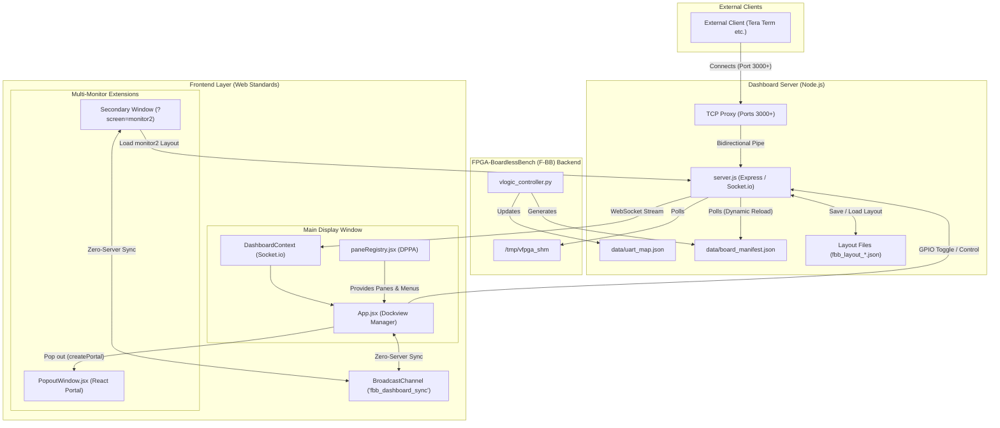
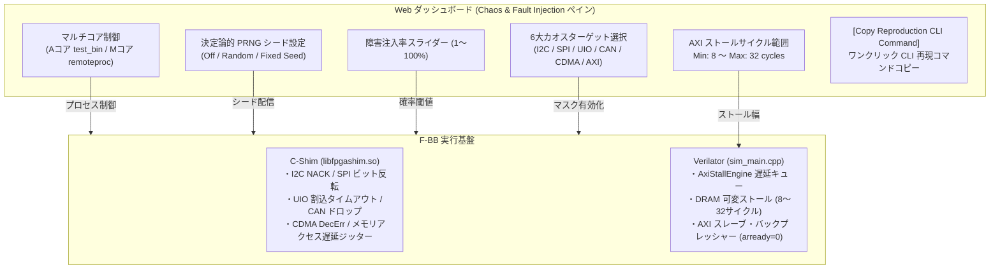

# dashboard/ - 仮想 FPGA 診断ダッシュボード

このディレクトリには、仮想 FPGA の内部レジスタ状態をリアルタイムに監視し、UART コンソールへのアクセスを提供する Web ベースの診断インターフェースが収められています。

## 役割 (Role)

- **リアルタイム監視**: 共有メモリ (SHM) を監視し、RTL シミュレータ上のレジスタ値をダッシュボードへブロードキャストします。また `mmio:write` による外部プラグイン・シミュレータからの汎用MMIOレジスタ書き込み（双方向同期）をサポート。
- **レジスタ履歴 (Tracer)**: レジスタの変化を時系列で記録し、正規化された波形として表示します。
- **GPIO インジェクション**: ダッシュボード上のトグルスイッチを操作することで、シミュレーション中の GPIO 入力状態をリアルタイムに変更できます（他レジスタを巻き込まない 4 バイト局所アトミック書き込みによる非侵襲設計）。
- **UART ブリッジ統合**: 複数の UART デバイス（PTY/TCP ブリッジ）を集約し、ブラウザ上のターミナルから操作可能にします。64KB 歴史バッファにより起動時の初期メニューやログの取りこぼしを防止します。
- **カオス・障害注入 ＆ マルチコア・ライフサイクル制御**: 実行中コア（Aコア/Mコア）の個別選択再起動、シード指定（Off/Random/Fixed）による決定論的障害注入（I2C/SPI/UIO/CAN/CDMA/AXIバス競合）、可変レイテンシ・ストールサイクル範囲指定、および障害発生ログのリアルタイム通知を行います。
- **自動化 (Macros)**: `login:` 等の特定の文字列を検知して自動的にレスポンスを返すマクロ機能を備えています。
- **ハイブリッド・マルチスクリーン & ペイン切り離し (Pop-out)**: 各ペインのタブから別ウィンドウへのワンクリック切り離し（Pop-out）、およびサブモニタ用のスクリーン別レイアウト管理（`?screen=monitor2`）に対応。
- **DPPA (Dashboard Pane Plugin Architecture)**: 宣言的ペインレジストリ（`paneRegistry.jsx`）により、ペインの実装・定義とウィンドウマネージャーを完全疎結合化。

## デフォルトペイン一覧＆操作リファレンス (Built-in Panes Reference)

F-BB が標準で提供する 15 種類のペイン（`paneRegistry.jsx`）の役割と操作方法の一覧です。ヘッダーの **`+ Add Pane`** メニューから任意のペインを個別追加・復元できます。

### 1. 観測・制御系 (Observability & Control)

| ペイン名 / 表示名 (ID) | 主な役割と可視化内容 | 主な操作方法・ショートカット |
| :--- | :--- | :--- |
| **Registers**<br>(`registerMonitor`) | 仮想 FPGA レジスタ（UIO/GPIO等）のアドレス・現在値（Hex/Dec）をデバイス毎にツリー表示。GTRサブグループ定義によるカード分割およびレスポンシブな縦展開に対応。 | ・**Trace チェックボックス**: Tracer への表示/非表示を動的切替。<br>・**GTR サブグループ表示**: DTS/GTRコメント（`/* ... */`）による論理グループ（Control, Status, Core 等）ごとのカード自動分割。<br>・**Layout 切替**: `Grid`（マルチカラムタイル配置）と `List`（単一カラム）の切替。<br>・**二重スクロール排除**: ペイン高さ（Dockview）に合わせた自然な縦展開。<br>・**TIME-TRAVEL 中**: 過去値をシアン色で表示。実機破壊を防ぐため自動で読み取り専用（`Read-Only`）ロック。 |
| **GPIO / Pin Array**<br>(`gpioPanel`) | SoC の GPIO ポート（LED・スイッチ・HUB75等）をグリッド表示。Active-Low / High を自動認識。 | ・**入力ピンをクリック**: High / Low をトグル注入。<br>・**TIME-TRAVEL 中**: 過去の点灯状態を復元。入力操作は自動ロック。 |
| **Tracer**<br>(`registerTracer`) | レジスタ値の変化履歴（最大500件）を追跡する正規化波形アナライザ。 | ・**波形クリック / なぞりドラッグ**: 該当スナップショットへ時間跳躍（Time-Travel）。全計器・3D画面が過去へ同期。<br>・**`SPAN` ボタン**: `50pt` / `100pt` / `250pt` / `All` でカーソル中心にオシロスコープ拡大。<br>・**モード切替**: `Zero-Center`（中央50%基準）/ `Signed`（符号付き自動レンジ）/ `Unsigned`。<br>・**`◄` / `►` キー**: 1フレーム単位で過去/未来へコマ送り・コマ戻し（`Shift` 同時押しで 10フレームジャンプ）。<br>・**`Esc` キー / `Return to LIVE` ボタン**: リアルタイム最新波形へ一発復帰。 |
| **CAN Bus Analyzer**<br>(`canAnalyzer`) | 仮想 SocketCAN（CANopen / J1939等）の全パケット送受信ログをリアルタイム表示。 | ・**送信フォーム**: ID・DLC・Data を入力して `Send` で CAN フレームを即時インジェクション。<br>・**フィルタ**: ID による特定メッセージの絞り込み。 |
| **Transaction Logger**<br>(`transactionLogger`) | C-Shim アクセストラッカーによるミリ秒単位のアクセス履歴およびプロトコル違反を監視。 | ・**自動検知**: Read-Only レジスタへの不正書き込み（`[PROTOCOL_VIOLATION]`）時に赤色アラートを表示。<br>・**Clear ボタン**: ログバッファをクリア。 |
| **Chaos & Fault Injection**<br>(`chaosEngine`) | 決定論的カオス障害（I2C/SPI通信化け、DMAタイムアウト、AXIバス競合・可変メモリストール等）のリアルタイム注入とマルチコア管理。 | ・**マルチコア制御**: Aコア / Mコアの稼働ステータス確認および個別再起動。<br>・**Seed 指定**: `Off` / `Random` / `Fixed`（シード値入力）による障害発生の 100% 再現。<br>・**スライダー & 数値入力**: 障害発生率（0〜100%）、ペリフェラル・インターフェース別有効化（I2C/SPI/UIO/CAN/CDMA/AXI）、および AXI 可変ストールサイクル範囲（Min〜Max サイクル）指定。<br>・**CLI 再現コマンドコピー**: UI 上で設定したシード・ターゲット・ストール範囲を反映した CLI 実行コマンドをワンクリックコピー。 |
| **DTS Visualizer & AI**<br>(`dtsVisualizer`) | 32-bit物理アドレス空間全体を一括俯瞰する一体型メモリマップ。DTS 構文エラーの AI 診断。 | ・**ブロッククリック**: デバイスのアラインメント、レジスタ構成、未割り当て空き空間（Unmapped Gap）を直下展開。<br>・**AI Smart DTS Check**: Ollama LLM と連動し、DTS コンパイルエラーの自然言語解説と Fix Diff を提示。 |

### 2. シリアル端末系 (Serial Terminals)

| ペイン名 / 表示名 (ID) | 主な役割と可視化内容 | 主な操作方法・ショートカット |
| :--- | :--- | :--- |
| **UART Console**<br>(`uartTerminal`) | シミュレーション内の UART ポート（TCP 2000〜）と接続する Web ターミナル。 | ・**キー入力**: ファームウェアの対話シェルを直接操作。<br>・**マクロ機能**: `login:` 等の文字列に対する自動応答設定。<br>・**外部接続**: ホスト PC の Tera Term 等（ポート 3000〜）から接続した場合も内容をリアルタイム相互同期。 |

### 3. ペリフェラル・入出力系 (Peripherals & I/O)

| ペイン名 / 表示名 (ID) | 主な役割と可視化内容 | 主な操作方法・ショートカット |
| :--- | :--- | :--- |
| **Virtual Peripheral View**<br>(`genericPeripheralPane`) | PPA 2.0 に基づく汎用ペリフェラル基板ビュー。ベクターグラフィック（`board.svg`）を高品質レンダリング。 | ・**マウス操作**: 50%〜400% ズーム、クリック＆ドラッグによる自由な視点移動（パンニング）。<br>・**制御スライダー**: 接続中のセンサー（ADC等）の入力電圧・物理値をリアルタイム操作。<br>・**スタンバイ画面**: プラグイン非接続時はシックなスタンバイ画面を表示。 |
| **Virtual SD Card**<br>(`sdCard`) | 仮想 SD カードイメージのマウント状態とファイルシステム監視。 | ・**ファイル一覧**: SD カード内の保存ファイル一覧をツリー表示。<br>・**ファイルダンプ**: イメージ内のファイルをホスト PC へ直接ダウンロード。 |
| **HDMI Output Preview**<br>(`hdmiOutput`) | 仮想 FPGA のフレームバッファから出力される映像信号（HDMI）のプレビュー。 | ・シミュレータが描画した画面フレームをリアルタイム表示。 |

### 4. 拡張・ロボティクス系 (Add-ons & Robotics)

| ペイン名 / 表示名 (ID) | 主な役割と可視化内容 | 主な操作方法・ショートカット |
| :--- | :--- | :--- |
| **ros2_control Status & Jitter**<br>(`ros2ControlStatus`) | 1kHz 決定論的リアルタイム制御ループのジッター計測。 | ・リアルタイムループの平均ジッター（Avg Jitter）および最大ジッター（Max Jitter）を $\mu$s 単位で監視。 |
| **ROS 2 Joint Tracking Waveform**<br>(`ros2JointWaveform`) | 左右車輪モーターの目標角速度（Cmd）と実測エンコーダ値（Actual）の追従性波形。 | ・左右ホイールの追従誤差（Velocity Error）や PID 応答波形をリアルタイム解析。 |
| **ROS 2 Teleop & E-STOP Console**<br>(`ros2TeleopConsole`) | 自律走行ロボット（AMR）の手動操縦およびハードウェア非常停止制御。 | ・**操縦操作**: 画面上の仮想ジョイスティック、またはキーボードの `W`/`A`/`S`/`D` キーによる直感走行操縦。<br>・**Space キー / STOP**: 即座に速度ゼロ停止。<br>・**E-STOP ボタン**: ハードウェア非常停止回路のトリガー＆障害復旧（Recovery）。 |
| **AMR 2D Pose & Map**<br>(`ros2PoseMap2D`) | 左右車輪オドメトリから積算された 2D 自己位置（X, Y, $\theta$）と走行軌跡の描画。 | ・ロボットの走行ルート、旋回挙動（ピボットターン）、および現在位置ベクトルを平面マップ上にプロット。 |

## アーキテクチャ図



## 主要なファイル

- **`server.js`**: ダッシュボードのバックエンドエンジン。
    - ポート 8080 で待機。
    - マニフェストと共有メモリを読み取り、WebSocket (`socket.io`) でフロントエンドに配信。
    - UART ブリッジ（TCP ポート 2000〜）との中継、および外部端末（TeraTerm等）接続用のTCPプロキシサーバー（ポート 3000〜）の起動と相互転送を担当。
    - スクリーン別レイアウト永続化 API (`GET/POST /api/layout?screen=...`) を提供。
- **`client/`**: フロントエンド（React 19）のソースコード。
    - **`src/panes/paneRegistry.jsx`**: DPPA (Dashboard Pane Plugin Architecture) の中核。全ペインのメタデータ、コンポーネント、Lucide アイコン、動的メニュー分類を一元管理。
    - **`src/components/PopoutWindow.jsx`**: React 19 `createPortal` を利用したペイン切り離し（子ウィンドウ化）マネージャー。スタイルシートの完全同期と自動リドックを提供。
    - **`src/components/DockHeaderActions.jsx`**: Dockview タブヘッダー拡張。各ペインのタブ右上にポップアウト切り離しボタンを配置。
    - **`src/components/DashboardContext.jsx`**: WebSocket 受信状態および `BroadcastChannel` による画面間ステート同期プロバイダー。
    - **`src/App.jsx`**: ペインの詳細から切り離された純粋な Dockview ウィンドウマネージャー。
- **`data/`**: 動的に生成されるマニフェストや UART マップファイルの格納場所。

## ハイブリッド・マルチスクリーン & ペイン切り離し機能 (Hybrid Multi-Screen & Pop-out)

複数モニタを持つ開発者のために、ダッシュボードの表示領域を物理的な別ディスプレイへ拡張する 3 つの柔軟なアプローチを提供します。

### 1. ワンクリック・ポップアウト（Pop-out to separate window）
- 各 Dockview タブの右上にある **「External Link」アイコン** をクリックすると、そのペインが新しいブラウザウィンドウとしてポップアップします。
- **React 19 `createPortal`** を利用しているため、WebSocket 接続やコンポーネントの React ステートはメインウィンドウと完全に共有されます。
- ポップアウトウィンドウ上部の **「Re-dock to Main Window」** ボタンを押すか、子ウィンドウを閉じるだけで、メイン画面の元のドック位置へ瞬時に復元されます。

### 2. モニタ別コックピット化 (`?screen=<id>`)
- サブモニタのブラウザで URL に `?screen=...` を付与して開きます（例: `http://localhost:8080/?screen=monitor2`）。
- 画面上部ヘッダーに `SCREEN: monitor2` バッジが表示され、レイアウトの保存・読み込みがモニタ専用ファイル（`fbb_layout_monitor2.json`）として独立して行われます。メインモニタとサブモニタでそれぞれ異なるペイン配置を保存・自動復元可能です。

### 3. 単体ペイン全画面モード (`?pane=<id>`)
- 特定のペインだけを画面いっぱいに表示したい場合（例: プロジェクター投影や専用ディスプレイ表示）、URL に `?pane=...` を付与します（例: `http://localhost:8080/?pane=peripheral_ssd1306` や `http://localhost:8080/?pane=uart_1`）。
- Dockview ヘッダーや外枠を排した 100% 全画面表示となります。

### 4. 画面間ゼロオーバーヘッド同期 (`BroadcastChannel`)
- 複数画面を開いた際、サーバーへの通信負荷をかけずに、ブラウザ標準の `BroadcastChannel('fbb_dashboard_sync')` を介して UI 状態（Tracer で非表示にしたレジスタキー等）がリアルタイムに相互同期されます。

## カオス ＆ 障害注入エンジン制御機能 (Chaos & Fault Injection Engine)

ダッシュボードの **Chaos & Fault Injection ペイン (`chaosEngine`)** は、実機（Pynq-Z2等）でしか起きない突発的な通信障害、タイムアウト、および AXI バス帯域競合・DRAM 遅延ストールを、Web UI 上から決定論的シード（PRNG）に基づいて自在に注入・再現・検証できる対話型デバッグコンソールです。



### 主な機能と操作方法

1. **マルチコア・プロセスライフサイクル制御**:
   - シナリオ内で稼働中の各コアプロセス（Aコア Linux アプリケーション `test_bin`、Mコア RTOS `remoteproc*` 等）の PID と稼働状態（`RUNNING` / `IDLE`）を一覧表示。
   - チェックボックスによる対象コアの個別選択と、`[Start]` / `[Stop]` / `[Restart Scenario]` による安全なプロセス再起動。

2. **決定論的シード（PRNG）再現モード**:
   - **`Off`**: カオス注入を完全無効化（ゼロオーバーヘッド通常実行）。
   - **`Random Seed`**: 実行ごとにランダムな 64-bit シードを自動採番して未知の障害シナリオを探索。
   - **`Fixed Seed`**: 入力した特定のシード値に基づき `xorshift128+` / SplitMix64 により同一の乱数系列を決定論的に再現。サイコロアイコンをクリックで新しいランダムシードを即座に再ロール。

3. **6大カオスターゲットと障害内容**:
   - **I2C (NACK)**: センサー/EEPROM 通信時の NACK 応答および EIO/ENXIO エラー注入。
   - **SPI (Bit-Flip)**: 全二重 SPI 転送データの任意ビット反転（パリティ・チェックサム検証用）。
   - **UIO (Timeout)**: 割り込み待機（`read()` / `eventfd`）時の `ETIMEDOUT` タイムアウト注入。
   - **CAN (Drop)**: SocketCAN ネットワークにおけるフレーム欠落（パケットドロップ）。
   - **CDMA (DecErr)**: AXI CDMA 転送時のデコードエラー（`DMADecErr`）ステータス反転。
   - **AXI (Stall/DRAM)**: AXI4 Read Channel (`arvalid`/`arready`/`rvalid`/`rready`) への可変遅延キュー挿入。PS側 DRAM の帯域競合によるストール、およびバッファ満杯時のスレーブ・バックプレッシャー（`arready=0`）を完全再現。

4. **AXI ストールサイクル範囲（Min / Max cycles）の直感的調整**:
   - `AXI (Stall/DRAM)` を有効化すると、直下にストールサイクル入力ボックス（`Min: 8` 〜 `Max: 32`）が自動展開。
   - CGB 2倍速モード（0.5$\mu$s デッドライン）のオーディオ FIFO や DMA バッファに対し、ストール期間をリアルタイムに変更してアンダーラン限界値をグラフィカルに検証可能。

5. **ワンクリック CLI 再現コマンドコピー**:
   - **`[Copy Reproduction CLI Command]`** ボタンを押すと、画面上の設定（アクティブシナリオ名、シード値、選択中ターゲット、ストールサイクル範囲）を反映した完全なコマンドがクリップボードへコピーされます：
     ```bash
     bin/fbb test 01e_axi_contention_audio --chaos --seed=7080345091724213768 --chaos-targets=i2c,spi,uio,can,cdma,axi_stall --stall-min=8 --stall-max=32
     ```
   - CI/CD パイプラインやローカルターミナルへ即座にペーストして 100% 同一の障害を再現できます。

6. **リアルタイム実行ログ ＆ 障害発生フィード**:
   - ファームウェアの標準出力、および `/tmp/fbb_chaos_injection.log` からの障害発生通知（`[CHAOS_AXI_STALL]`、`[CHAOS_FAULT]` 等）をリアルタイムに集約表示。
   - 注入された総障害数バッジのカウントアップと、ピンク／赤／緑のカラーハイライトにより、どのタイミングでどの障害が発生したかを一目で把握できます。

## 外部UART接続プロキシ機能 (TCP Proxy)

ダッシュボードは、シミュレータ内のUARTデバイスとブラウザ上のコンソールの通信を仲介するだけでなく、ホストPC上の外部ターミナルエミュレータ（Tera Termなど）がコンテナ内のファームウェアと直接通信するためのTCPプロキシ機能を内蔵しています。

### アーキテクチャとポート対応
- **シミュレータ側（Pythonブリッジ）**: ポート `2000` (UART1), `2001` (UART2) などでリッスンします。
- **ダッシュボードプロキシ（Node.js）**: ポート `3000` (UART1), `3001` (UART2) など（Pythonポート + 1000番）でリッスンし、外部クライアントからの接続を受け付けます。

### 特徴
1. **リアルタイム・スニッフィング**: Tera Term 等から送信・受信されたすべての通信データはダッシュボード側にも WebSocket 経由で即時ミラーリングされ、ブラウザと外部クライアントの両方で同時に通信を監視できます。
2. **ログ再生 (Replay)**: 外部クライアントが新しく TCP 接続した際、それまでにファームウェアが出力した過去のログバッファ（最大5000文字）を自動的に再送（リプレイ）し、接続前のやり取りも復元します。
3. **入力同期 (Echo)**: Webダッシュボード上の入力フォームから送信したデータも、外部クライアント側の画面にエコーバック（画面同期）され、操作ログが一貫して表示されます。

## 使用方法

通常、`start_lab.sh` によって自動的に起動されますが、フロントエンドのビルドおよびパッケージインストールを含めてダッシュボードをリビルド・手動起動する場合は、以下の手順に従います。

### リビルド方法 (Rebuild)
```bash
./dashboard/rebuild_dashboard.sh
```

### 手動での起動方法 (Manual Start)
```bash
cd dashboard
node server.js
```

ブラウザで **`http://localhost:8080`** を開くとダッシュボードにアクセスできます。

## API エンドポイント

- `GET /api/manifest`: 現在ロードされているボード構成情報（`board_manifest.json`）を返します。
- `GET /api/layout`: 現在アクティブなシナリオのフォルダから UI レイアウト情報（`fbb_layout.json`、または `?screen=<id>` 指定時は `fbb_layout_<screen>.json`）を読み込みます。
- `POST /api/layout`: 現在アクティブなシナリオのフォルダへ UI レイアウト情報（`fbb_layout.json`、または `?screen=<id>` 指定時は `fbb_layout_<screen>.json`）を保存します。
- `GET /api/scenario/cores`: 実行中のシナリオ内の各コアプロセス（Aコア/Mコア等）の PID および稼働状態を取得します。
- `POST /api/scenario/stop`: 実行中のシナリオ（または指定された個別コア）を停止します。
- `POST /api/scenario/restart`: シナリオ（または指定された個別コア）を停止し、指定されたカオス設定を適用して再起動します。
- `POST /api/chaos/config`: カオス障害注入設定（有効/無効、シード値、障害率、ターゲット）を更新・配信します。
- `GET /api/dts/tree`: 32-bit物理アドレス空間のメモリマップ割り当て、デバイス間/High/Low未割り当て空間（Unmapped Gap）サイズ、および重なり検知ステータスとDTSソースを取得します。
- `POST /api/dts/diagnose`: DTSエラーメッセージをローカルLLM (Ollama/qwen3.6) へ投入し、AIによる自然言語解説と推奨Fix Diffを取得します。
- `GET /api/sdcard/status`: 仮想 SD カードの現在のマウント・エミュレーションステータスを取得します。
- `GET /api/sdcard/list`: 仮想 SD カードイメージ内のファイル一覧を取得します。
- `GET /api/sdcard/dump`: 仮想 SD カードイメージから指定したファイルをダウンロードします。

## 設計上の配慮 (Design Philosophy)

1. **Backend Decoupling**: Python 側の制御ロジックと Node.js 側の可視化ロジックを分離することで、UI 側の操作がシミュレーションのリアルタイム性に影響を与えないように設計されています。
2. **Auto-Discovery**: `data/board_manifest.json` を監視し、新しいデバイスが追加されるとダッシュボードへ自動的に反映されます。
3. **Interactive Splitting**: フロントエンドに `Dockview` を採用し、ユーザーが複数の UART ペインをドラッグ＆ドロップで自在に分割配置して同時監視できるようにしています。
4. **Non-Invasive SHM Access (非侵襲共有メモリアクセス)**: 200ms ごとの状態監視ループは完全なリードオンリー（Read-Only）とし、不要なディスク書き込みを排除。UI からの GPIO トグルや仮想ペリフェラル操作時のみ、該当レジスタの特定オフセットへ最小限の局所バイナリ書き込み（pwrite）を行うことで、並行実行されるファームウェアやシミュレータのレジスタ更新との競合・データ破壊を防止しています。
5. **DPPA & Hybrid Multi-Screen (疎結合ペインプラグインとマルチモニタ拡張)**: バックエンドの PPA (ADR #005) と同期した設計思想により、ペインの定義・アイコン・メニュー分類をレジストリ（`paneRegistry.jsx`）へ完全分離（開閉原則 OCP 準拠）。さらに、Electron などのヘビーな外部ネイティブアプリに頼らず、Web 標準技術（React 19 `createPortal`、`BroadcastChannel`）のみでゼロ・インストール＆ゼロ・オーバーヘッドなマルチモニタ環境を実現しています。
