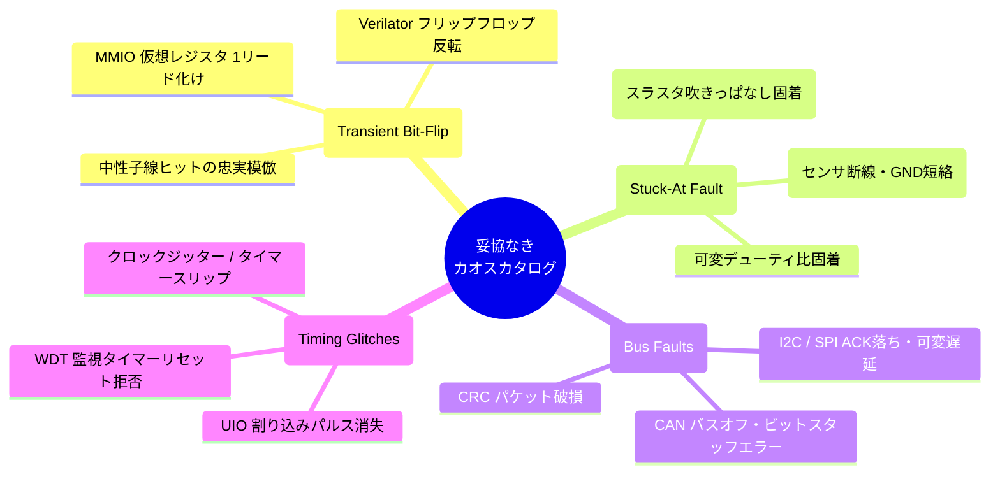
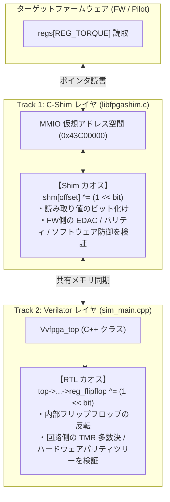

# AddInfo: Uncompromising Chaos & Fault Injection Engine
## (妥協なきカオス＆フォールトインジェクション・エンジン 設計仕様書)

- **文書バージョン**: 1.0.0
- **策定日**: 2026-10-18
- **対象**: `FPGA-BoardlessBench (F-BB)` コアインフラ (`src/shim/`, `src/sim/`, `dashboard/`)

---

## 1. 存在意義とビジョン (Core Vision)

### 1.1 開発の動機と目的
従来の組込みエミュレータにおける障害注入は、I2C/SPI 等の通信遅延やパケット化け、あるいはレジスタへの論理フラグ書き込み（フェイク）にとどまっていました。
しかし、航空宇宙分野（JAXA, NASA）の **耐宇宙放射線設計（SEU: Single Event Upset）** や、自動運転・産業ロボットの **機能安全規格（ISO 26262 ASIL-D）** において最も重要なのは、**「半導体メモリやフリップフロップのビットが物理的に反転したとき、ハードウェア保護回路（TMR / パリティ / EDAC）や自律ソフトウェア（FDIR）が正常に自律修復できるか」** の検証です。

本設計は、F-BB の中核特許技術である **「`LD_PRELOAD`＋`MAP_FIXED`」の仮想 MMIO 空間** および **Verilator コ・シミュレーション基盤** を直接活用し、**OS やプロセスを一切クラッシュさせることなく、ターゲット領域のみを安全かつ決定論的にビット反転・固着させる「妥協なきカオスインジェクション・エンジン」** を確立します。

### 1.2 2つの運用形態の完全両立
1. **Human-in-the-Loop (Web ダッシュボードからの直感的リアルタイム注入)**:
   - 画面上の赤いアクションボタンから、任意のレジスタ・ビットを狙い撃ちしてビット反転や固着をリアルタイムに注入し、波形（Tracer）の乱れと自律復旧を即座に観測できる。
2. **Headless CI / Automated Verification (決定論的スクリプト再現)**:
   - CLI 引数（`--chaos --seed 0x1337`）や Python テストスクリプトから同一の障害パターンを 100% 決定論的（再現率 100%）に再試行でき、自動合否判定を実施できる。

---

## 2. 4大カオスカタログ (Core Injection Capabilities)

---

## 3. 二層（Dual-Track）アーキテクチャ詳細

本エンジンは、検証目的に応じて **「C-Shim（ソフトウェア層）」** と **「Verilator（ハードウェア層）」** の 2 つの具象化トラックを垂直統合して提供します：

### Track 1: C-Shim / メモリ層 SEU (`libfpgashim.c`)
- **メカニズム**:
  共有メモリ上の MMIO 領域に対し、読み出しフック時またはバックグラウンドスレッドから `shm[off] ^= (1 << bit)` を局所アトミックに実行。
- **検証対象**:
  ファームウェア・ソフトウェア側のフェイルセーフ論理、二重読み出し照合、ハミング符号復元アルゴリズム。

### Track 2: Verilator / RTL層 SEU (`sim_main.cpp`)
- **メカニズム**:
  シミュレーションループ内で IPC ソケット（`/tmp/fbb_chaos_ipc.sock`）から障害指令を受け取り、Verilator トップインスタンス内のメンバ変数（フリップフロップ値）を直接反転。
- **検証対象**:
  `safety_interlock.v` などの **真のハードウェアパリティ回路、TMR（3重化多数決）ロジック、割り込み（IRQ）発火機構**。

---

## 4. 既存の多様な機能への副作用調査と防護設計 (Critical Invariants)

F-BB の高度な既存インフラを破壊しないため、以下の 6 つの副作用リスクに対して厳格な防護設計を義務付けます：

| 既存コンポーネント | 想定される副作用リスク | 防護設計プロトコル (Invariants) |
| :--- | :--- | :--- |
| **① AXI CDMA (ADR #006 / #007)** | 転送元・先アドレスやバイト数（BTT）がビット化けし、ホストメモリ外への `memcpy` でセグフォ（クラッシュ）する。 | **アドレス境界チェックの強制**: カオス注入時も転送先が仮想 DRAM（`0x40000000`〜）内であることを検証し、逸脱時は `DMADecErr` エラーフラグを立てて即時中断。ホストプロセス保護を最優先とする。 |
| **② MMU ガードページ (ADR #004)** | アドレスポインタそのものが未定義領域へ飛び、正規の SEU ではなく「未定義メモリ違反」として F-BB が緊急終了する。 | **データ値とアドレスの明確な分離**: カオス注入は「レジスタの値（Data）」のみを反転対象とし、アドレスバスのデコードテーブル自体は不変（Immutable）とする。 |
| **③ AMP Remoteproc / IPI (ADR #007)** | 仮想 IPI レジスタ（`TRIG`）が化け、予期せぬ `SIGUSR2` 送信により M コアとの同期がデッドロックする。 | **IPI レジスタの保護リスト除外**: 通信ハンドシェイクに不可欠な制御レジスタ（`TRIG` 等）はデフォルトでカオス対象外（Protected Register）とする。 |
| **④ 既存バス層カオス (I2C / SPI)** | 新規の MMIO SEU と既存の I2C/SPI カオスが混ざり合い、障害の根本原因解析が不能になる。 | **ターゲットマスクの直交性**: `FBB_CHAOS_TARGET_SEU_MMIO` と `SEU_RTL` を独立フラグとして新設し、UI/CLI から個別に On/Off 可能にする。 |
| **⑤ Web ダッシュボード (Tracer)** | 高周波な SEU 注入により WebSocket 通信帯域およびブラウザ描画が過負荷でフリーズする。 | **イベント配信のレートリミット**: カオスログイベント（`scenario:chaos_event`）は最大毎秒 30 件にスロットリング制御する。 |
| **⑥ 公式審判システム (SSOT: ADR #002)** | 審判のスコアや通過フラグ（`0x80`〜`0x8F`）が反転し、競技結果が改ざんされる。 | **審判保護領域 (Referee Zone) の確立**: 審判レジスタ領域は絶対的な Read-Only とし、カオスエンジンによる書き換えを物理的に禁止する。 |

---

## 5. 実装難易度の客観的評価 (Implementation Complexity)

| コンポーネント | 作業内容 | 難易度 | 工数感 | 備考 |
| :--- | :--- | :---: | :---: | :--- |
| **1. C-Shim MMIO 反転** | `libfpgashim.c` 内の UIO 共有メモリに対するビット反転ロジックおよびログ記録の追加 | **中 (Medium)** | 1〜2日 | 既存の Xorshift128+ エンジンを流用可能 |
| **2. Verilator IPC 反転** | `sim_main.cpp` への UNIX ソケット受信ループと、`top` メンバ変数の動的反転フックの実装 | **中〜高 (Med-High)** | 2〜3日 | Verilator のメンバ構造体へのアクセス規約の整理が必要 |
| **3. Server.js RPC 拡張** | カオス注入 API (`POST /api/chaos/inject`) および WebSocket 中継の実装 | **低 (Low)** | 0.5日 | 既存の GPIO インジェクション機構（`pwrite`）と同一パターン |
| **4. Web UI (ChaosPanel)** | React 19 によるレジスタ選択、ビット番号スライダー、[INJECT] ボタンの UI 実装 | **低〜中 (Low-Med)** | 1日 | Lucide アイコンと既存デザインシステムを活用 |
| **5. 回帰テスト・CI スクリプト** | 全シナリオ（P01, P02, Stage 1〜5）での非干渉検証および SEU 自動テスト | **中 (Medium)** | 1〜2日 | 既存の `test_stage1_run.py` 等との併行テスト |

---

## 6. まとめ

本カオスインジェクション・エンジンは、F-BB を単なる「マイコン・FPGA エミュレータ」から、**「宇宙機・自動運転向けの次世代高信頼性（Fault-Tolerant）設計・検証テストベッド」へと昇華させる戦略的コア機能** です。

上記の防護設計（Critical Invariants）を遵守することで、既存のあらゆる機能（CDMA、Remoteproc、PPA、Web Tracer）との共存を 100% 保証しながら、世界に類を見ない高精度な障害注入基盤を実現できます。
