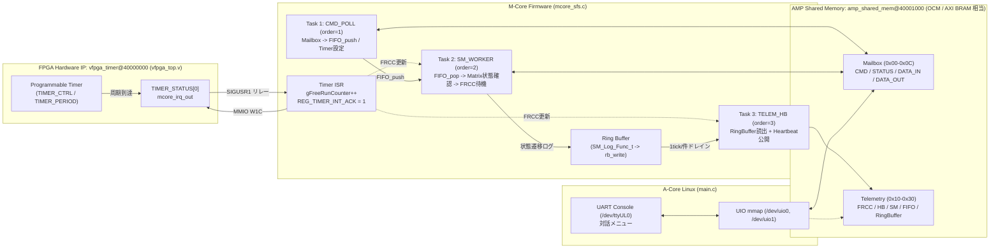

# 23_amp_mcore_sfs: 依存ゼロ C89 スケジューラ（SFS）× ハードウェアタイマー割り込み

Zynq-7000 / ZynqMP などの実機 AMP（非対称マルチプロセッシング）開発において、A コア（Linux）の背後で動く M コア（Cortex-R5 / Cortex-M）は、必ずしも FreeRTOS や ThreadX のようなフル機能のプリエンプティブ RTOS を載せるわけではありません。安全規格対応や決定論的実行、メモリ節約の観点から「**単一スーパー・ループよりは構造化したいが、重い OS は不要**」という場面が多く存在します。

本シナリオは、標準 C ライブラリ非依存の C89 タスクスケジューラ **[simple-functions-scheduler (SFS)](https://github.com/sirosiro/simple-functions-scheduler)** を M コアで動作させ、**`pthread` を使わない実機透過な FPGA ハードウェアタイマー割り込み**と組み合わせて検証する実践テンプレートです。

---

## このシナリオのゴール
1. **SFS 全 5 コンポーネントの協調動作**: `SFS`（協調型スケジューラ）・`FRCC`（フリーランカウンタ）・`FIFO`（キュー）・`Matrix`（3 次元状態機械）・`Ring Buffer`（遷移ログ）を M コア上で統合実行する。
2. **純粋な HW/SW 境界分離**: FPGA RTL（`vfpga_timer@40000000`）はタイマー IP のみに限定し、A コア ↔ M コア間のコマンド／ステータス共有は OCM / AXI BRAM 相当の共有メモリ（`amp_shared_mem@40001000`）へ分離する。
3. **Time-Travel Debugging による動作観察**: UART 対話コンソールからの操作（`Pause → Burst 4x → Resume` 等）を、`Register State Tracer` で巻き戻しながら時系列検証する。

---

## 全体構成図（HW / SW 境界とデータフロー）



---

## 1. 2 つの動かし方

### ① 自動回帰テストとして実行（CLI）
ビルド時に `simple-functions-scheduler`（最新 `master`）が自動クローンされ、以下の 5 項目を自動検証します。

```bash
# シナリオディレクトリ内から実行
cd tests/scenarios/23_amp_mcore_sfs
./run.sh

# またはリポジトリルートから実行
./tests/scenario_runner.sh tests/scenarios/23_amp_mcore_sfs/
```

**自動検証される 5 項目:**
1. FPGA ハードウェアタイマー割り込み（`TIMER_HW_CNT >= 2`）が M コア ISR を駆動し、`FRCC_TICKS >= 2`・`HEARTBEAT_CNT >= 1` が進むこと
2. `CMD_SM_START` により Matrix が `IDLE -> ACTIVE` へ遷移し、Ring Buffer 経由で `LAST_TRANSITION`（`0x00000001`）が記録・回収されること
3. `Pause`（`SUSPENDED`）中に 3 件連続 `CMD_ENQUEUE_DATA` すると `FIFO_DEPTH == 3` で滞留し、`Resume` 後に `FIFO_PROCESSED == 3`、`DATA_OUT == 91`（`30 * 3 + 1`）へ消化されること
4. `MODE_DIAGNOSTIC` へ切り替え後、入力 `42` が `420`（`42 * 10`）として処理されること
5. `CMD_SM_STOP` で `STATE_IDLE` へ戻り、`CMD_SHUTDOWN` で全タスクがクリーン終了すること

### ② Web ダッシュボードで対話操作＆Time-Travel 観察（Lab モード）

```bash
./bin/fbb lab tests/scenarios/23_amp_mcore_sfs/
```

ブラウザで `http://localhost:8080` を開くと、**UART コンソール**・**Register Monitor**・**Register State Tracer**・**DTS Visualizer** の 4 ペインが表示されます。UART コンソールから以下の操作を行えます：

| キー | 分類 | 操作内容 |
| :---: | :--- | :--- |
| `1`〜`4` | Matrix 状態機械 | `Start` (`IDLE->ACTIVE`) / `Pause` (`->SUSPENDED`) / `Resume` (`->ACTIVE`) / `Stop` (`->IDLE`) |
| `5` | 動作モード | `MODE_NORMAL`（`val * 3 + 1`, HB 周期 3）⇔ `MODE_DIAGNOSTIC`（`val * 10`, HB 周期 1）切替 |
| `6` / `7` | FIFO 投入 | 単発パケット投入 / 4 連発バースト投入（`FIFO_DEPTH` 変化の観察向け） |
| `8` | タイマー周期 | `TIMER_PERIOD` 切替（`500` 高速 / `1500` 標準 / `3000` 低速） |
| `9` / `0` | 監視・終了 | テレメトリスナップショット表示 / M コアシャットダウン終了 |

---

## 2. Time-Travel Debugging 観察ガイド

Web ダッシュボードの `Register State Tracer` を使って、タイマー割り込みとスケジューラの振る舞いを時系列で観察するおすすめ手順です。

1. **Trace 対象の選択**: `Register Monitor` で **`vfpga_timer`（`TIMER_HW_CNT`）** と **`amp_shared_mem`（`FRCC_TICKS`, `SM_STATE`, `FIFO_DEPTH`, `DATA_OUT`, `LAST_TRANSITION`）** の Trace チェックを確認します（Lab 起動時は Tracer の 200ms サンプリングに合わせ `TIMER_PERIOD = 1500` へ自動調整されています）。
2. **Pause → Burst 4x → Resume を実行**:
   - UART で `1`（Start）→ `2`（Pause）→ `7`（Burst Enqueue 4x Packets）を入力します。
   - `SUSPENDED` 状態では `SM_WORKER` が FIFO を取り出さないため、`FIFO_DEPTH` が `4` まで積み上がります。
   - 続いて `3`（Resume）を入力すると、`TIMER_HW_CNT` / `FRCC_TICKS` の進みに合わせて `FIFO_DEPTH` が `4 -> 3 -> 2 -> 1 -> 0` と階段状に消化され、`DATA_OUT` が順次更新されます。
3. **Time-Travel で巻き戻し確認**:
   - Tracer の波形をクリックまたは左右キー（◄ / ►）で過去へ戻し、`SM_STATE` 変化直後の `LAST_TRANSITION` 更新（`(mode << 24) | (old << 16) | (event << 8) | new`）と、2 ティック待機（`FRCGapCheckStart(..., 2)`）後に結果が出力される因果関係を 1 サンプルずつ確認できます。

---

## 3. メモリマップ＆コマンド早見表

### `vfpga_timer@40000000`（`/dev/uio0` — FPGA RTL タイマー IP）

| オフセット | レジスタ名 | 属性 | 用途 |
| :--- | :--- | :---: | :--- |
| `0x00` | `TIMER_CTRL` | `RW` | Bit 0: `ENABLE`（初期値 `0`。M コアが ISR 登録後に `1` を設定） |
| `0x04` | `TIMER_PERIOD` | `RW` | 割り込み周期（RTL クロック数） |
| `0x08` | `TIMER_STATUS` | `RO` | Bit 0: `IRQ_PENDING`（`mcore_irq_out` と直結） |
| `0x0C` | `TIMER_INT_ACK` | `WO` | Bit 0 に `1` 書込で割り込みフラグ解除（Read は常に `0`） |
| `0x10` | `TIMER_HW_CNT` | `RO` | FPGA ハードウェア側での累計割り込み発行回数 |

### `amp_shared_mem@40001000`（`/dev/uio1` — AMP 共有メモリ）

| オフセット | レジスタ名 | 用途 |
| :--- | :--- | :--- |
| `0x00`〜`0x0C` | `CMD`, `STATUS`, `DATA_IN`, `DATA_OUT` | A コア ↔ M コア間のコマンドハンドシェイク＆入出力データ |
| `0x10`〜`0x14` | `FRCC_TICKS`, `HEARTBEAT_CNT` | ISR 駆動の `FRCC` カウント値と `HEARTBEAT` タスク更新回数 |
| `0x18`〜`0x1C` | `SM_MODE`, `SM_STATE` | Matrix 状態機械の現在モード（`0`/`1`）および状態（`0:IDLE`/`1:ACTIVE`/`2:SUSPENDED`） |
| `0x20`〜`0x24` | `FIFO_DEPTH`, `FIFO_PROCESSED` | 現在の FIFO 滞留件数と累計処理完了件数 |
| `0x28`〜`0x30` | `LAST_TRANSITION`, `RB_USED_BYTES`, `RB_DRAINED_CNT` | Ring Buffer から回収された最新遷移ログ・使用量・累計回収数 |

**`CMD` コマンドコード**: `0x01` Start / `0x02` Pause / `0x03` Resume / `0x04` Stop / `0x05` Mode 変更 / `0xA1` FIFO データ投入 / `0xB1` タイマー周期変更 / `0xFF` 終了

---

## 4. ちょこっと改造チャレンジ！

- **チャレンジ 1（処理待ち時間の変更）**: [mcore_sfs.c](mcore_sfs.c) の `FRCGapCheckStart(&g_work_frc, 2UL);` の `2UL` を `5UL` に変えて、Lab モードで Burst 4x 実行時の階段間隔がゆっくり変化する様子を Tracer で観察してみましょう。
- **チャレンジ 2（Matrix 遷移テーブル拡張）**: [mcore_sfs.c](mcore_sfs.c) の `g_sm_table` に遷移時アクション関数を設定し、状態遷移時のイベント処理を拡張してみてください。

---

## さらに詳しく知りたい方へ
- `pthread` を使わないタイマー割り込み中継（`has_mcore_irq_out<T>`）、`sigprocmask` による割り込みマスク再現、および `TIMER_INT_ACK` や `CMD` の競合防止設計については **[ADVANCED.md](ADVANCED.md)** を参照してください。
- 関連シナリオ：[01b_uio_irq_interrupt](../01b_uio_irq_interrupt/README.md) / [09_remoteproc_amp](../09_remoteproc_amp/README.md) / [10_amp_mcore_freertos](../10_amp_mcore_freertos/README.md) / [18_amp_mcore_Rust_rtic](../18_amp_mcore_Rust_rtic/README.md)
